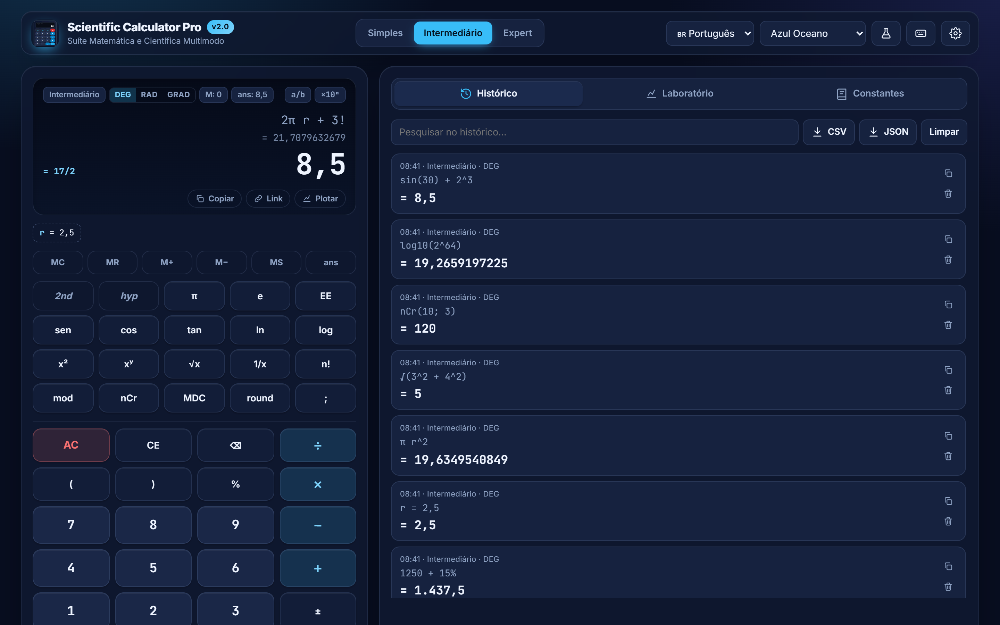
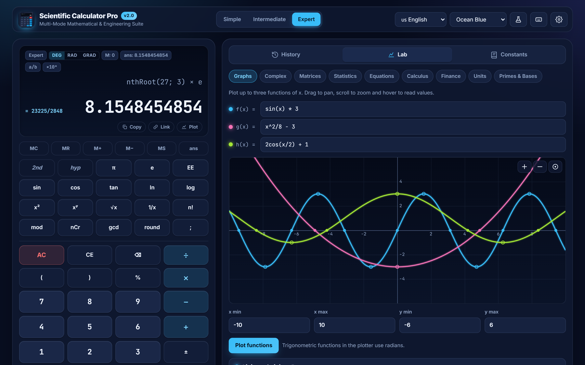
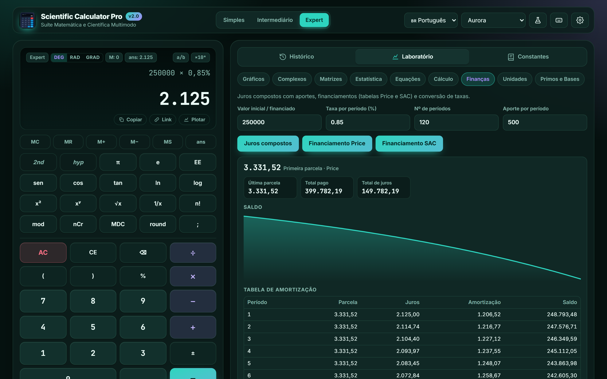
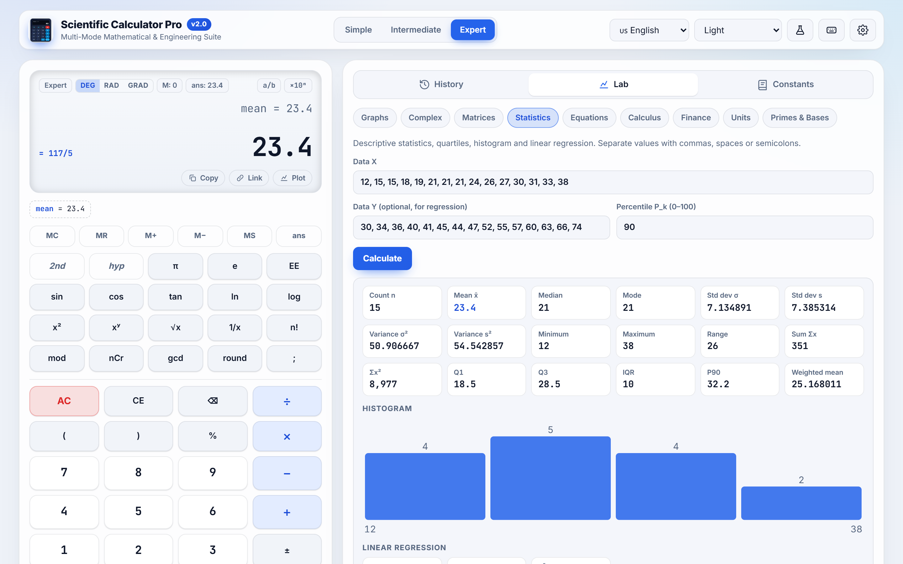
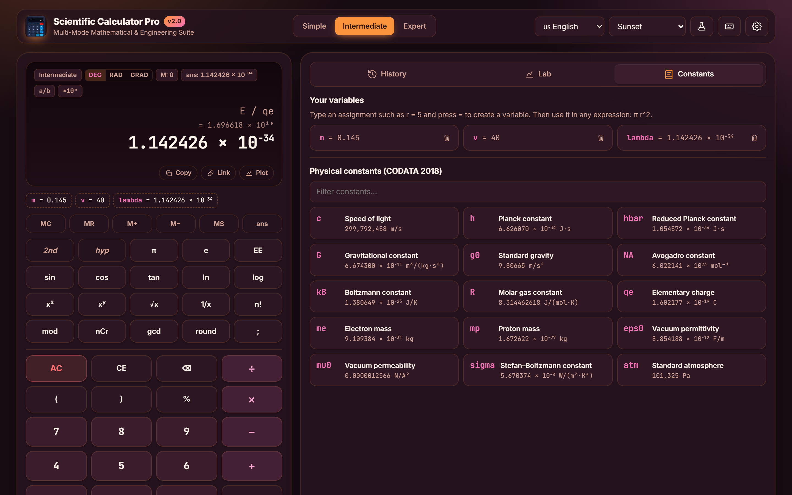
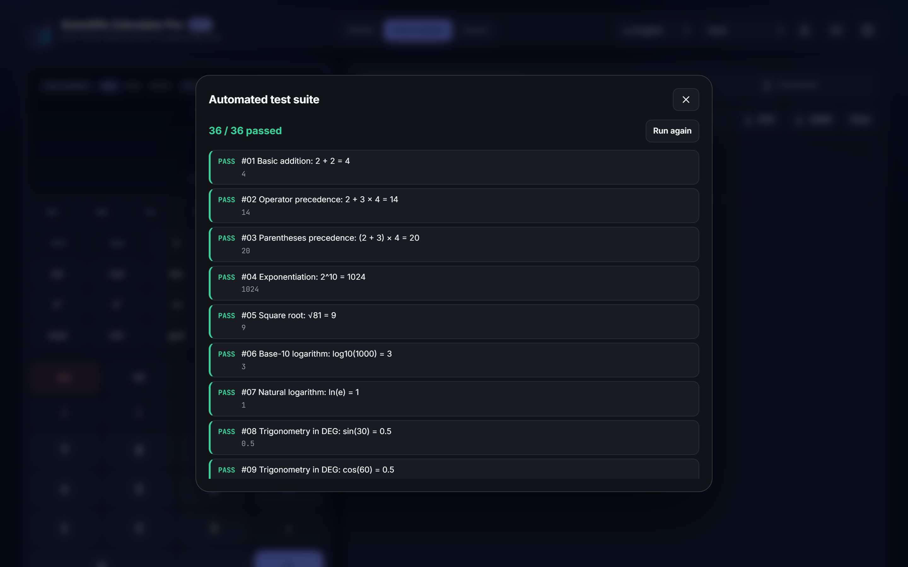
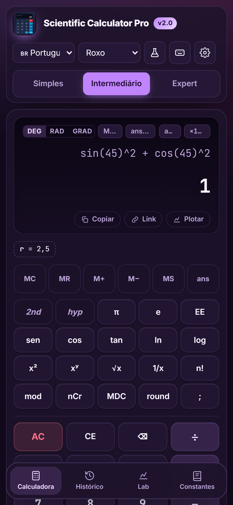
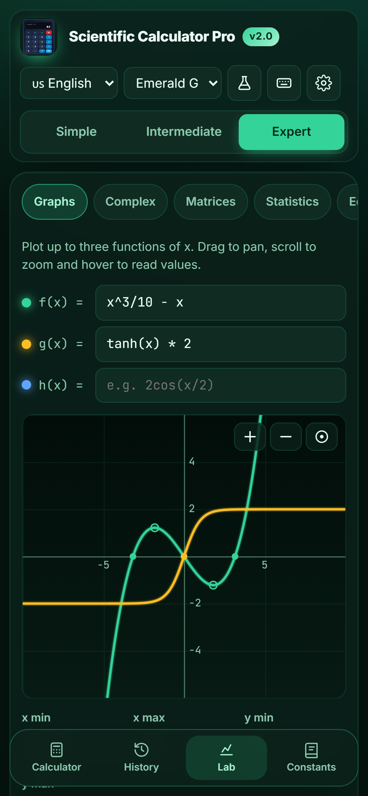

# 🧮 Scientific Calculator Pro — v2

[](CHANGELOG.md)
[](LICENSE)
[](#-automated-tests)
[](#-architecture)
[](#-progressive-web-app)
[](#-languages--regional-formatting)
[](#-themes--accessibility)

> A high-precision, multi-mode scientific calculator for the web — with a **function plotter**, a **finance lab**, **physical constants**, **user variables**, nine expert labs, 10 themes and 6 languages. Pure HTML, CSS and JavaScript: no build step, no runtime dependencies and **no `eval()`**.

### 🌐 [**Open the live app →**](https://marceloasl99.github.io/calculator/)

---

## 📸 Screenshots

| 💻 Desktop — scientific mode with live preview | 📈 Function plotter with roots, extrema and trace |
| :---: | :---: |
|  |  |
| *2nd/hyp keypad, variables (`r = 2,5`), live result preview, exact fraction (`= 17/2`) and a searchable, exportable history.* | *Three functions at once: drag to pan, scroll to zoom, hover to read every curve. Roots and extrema are found automatically.* |

| 💰 Finance lab — Price amortization (Aurora theme) | 📊 Statistics with histogram and regression (Light theme) |
| :---: | :---: |
|  |  |
| *Compound interest with contributions, Price and SAC loans with full schedule and balance chart, rate conversion.* | *17 descriptive measures, quartiles, percentiles, histogram and linear regression with r and R².* |

| ⚛️ Physical constants & variables (Sunset theme) | 🧪 Built-in test runner |
| :---: | :---: |
|  |  |
| *15 CODATA 2018 constants usable in any expression — here `λ = h / (m v)` for a baseball.* | *36 checks run live in the browser; 54 Node.js tests run with `npm test`.* |

| 📱 Mobile — calculator | 📱 Mobile — plotter |
| :---: | :---: |
|  |  |
| *Bottom navigation shows one panel at a time on phones.* | *Every lab works with touch: drag the graph to pan.* |

---

## ✨ What's new in v2

| Area | v1 | **v2** |
| :--- | :--- | :--- |
| Expert labs | 7 | **9** — new **Graphs** and **Finance** |
| Variables | — | **`r = 5`**, then `π r^2`; saved between sessions |
| Constants | π, e, φ | + **15 CODATA physical constants** (`c`, `h`, `NA`, `kB`, …) |
| Keypad | 35 fixed keys | **25 keys with 2nd / hyp layers**, like a physical calculator |
| Editing | append only | **Cursor-aware** insert & delete, `↑`/`↓` history recall |
| Result | on `=` only | **Live preview** while typing, `× 10⁻³⁴` notation |
| History | list | Click to reuse, **CSV / JSON export**, **share links** |
| Mobile | stacked panels | **Bottom navigation**, one panel at a time |
| Themes | 8 | **10** (+ Aurora, Sunset), accent color with automatic contrast |
| Tests | 39 | **54** Node.js + 36 in-browser |

Bugs fixed along the way: the Primes & Bases lab crashed on every action, the in-browser test runner **erased the saved history**, tiny values such as Planck's constant were rounded to 0, and `=` could repeat a stale operation. See the full [CHANGELOG](CHANGELOG.md).

---

## 📑 Table of Contents

1. [Modes](#-modes)
2. [Expert labs](#-expert-labs)
3. [Variables & physical constants](#-variables--physical-constants)
4. [Math engine & security](#-math-engine--security)
5. [Languages & regional formatting](#-languages--regional-formatting)
6. [Themes & accessibility](#-themes--accessibility)
7. [Quick start](#-quick-start)
8. [Keyboard shortcuts](#%EF%B8%8F-keyboard-shortcuts)
9. [Deep links](#-deep-links)
10. [Architecture](#-architecture)
11. [Automated tests](#-automated-tests)
12. [Progressive Web App](#-progressive-web-app)
13. [License](#-license)

---

## ⚙️ Modes

### Simple
Everyday arithmetic: `+ − × ÷`, parentheses, sign toggle, **contextual percentage** (`200 + 10%` → 220, `150 − 20%` → 120, `25%` → 0.25), memory register (`MC MR M+ M− MS`, persisted), `ans`, `AC`, `CE`, `⌫`, and repeated `=` (pressing `=` again repeats the last operation).

### Intermediate (scientific)
A 25-key scientific keypad with two extra layers:

| Key | Normal | **2nd** | **hyp** | **2nd + hyp** |
| :--- | :--- | :--- | :--- | :--- |
| sin / cos / tan | sin, cos, tan | asin, acos, atan | sinh, cosh, tanh | asinh, acosh, atanh |
| ln / log | ln, log₁₀ | eˣ, 10ˣ | | |
| x² / xʸ / √x | x², xʸ, √x | x³, ⁿ√x, ∛x | | |
| 1/x / n! | 1/x, n! | 2ˣ, \|x\| | | |
| mod / nCr / gcd / round | mod, nCr, gcd, round | log_b, nPr, lcm, floor | | |

Plus π, e (2nd: φ), `EE` (×10ⁿ), angle units **DEG / RAD / GRAD**, implicit multiplication (`2π`, `3(4+5)`, `2sin(30)`), an exact-fraction badge (`0.75` → `3/4`) and optional fraction or scientific display.

### Expert
Everything above plus the nine expert labs in the side panel.

---

## 🔬 Expert labs

| Lab | What it does |
| :--- | :--- |
| 📈 **Graphs** *(new)* | Plot `f`, `g`, `h` of `x`; pan, zoom, reset; hover tooltip with every curve's value; automatic roots (refined by bisection) and local extrema; correct breaks at asymptotes. |
| 🔵 **Complex** | `a + bi` arithmetic, conjugate, modulus, argument (DEG/RAD/GRAD), polar ↔ rectangular, De Moivre powers, all n-th roots. |
| 🔢 **Matrices** | 1×1 to 6×6: A ± B, A × B, k·A, Aᵀ, tr(A), det(A) (LU with pivoting), A⁻¹ (Gauss-Jordan, singularity detection), solve A·x = b. |
| 📊 **Statistics** | n, Σx, Σx², mean, median, mode(s), min/max, range, σ²/s², σ/s, Q1/Q3, IQR, any percentile, weighted mean, **histogram**, linear regression with r and R². |
| 🎯 **Equations** | Root of f(x) = 0 by bisection, Newton-Raphson or secant, with residual and iteration count. |
| 📐 **Calculus** | f′(x₀) and f″(x₀) by 5-point central differences O(h⁴); ∫ₐᵇ f(x) dx by adaptive Simpson, with error estimates. |
| 💰 **Finance** *(new)* | Compound interest with periodic contributions + balance chart; loans with **Price** (constant installment) or **SAC** (constant amortization) with full schedule; rate conversion (daily ↔ monthly ↔ yearly). |
| 🔄 **Units** | 13 categories (length, area, volume, mass, time, speed, acceleration, temperature, pressure, energy, power, frequency, angle) with a full conversion table. |
| 🧮 **Primes & Bases** | gcd/lcm, nPr/nCr, primality and prime factorization (`360 = 2^3 × 3^2 × 5`), BIN/OCT/DEC/HEX, 32-bit AND/OR/XOR/NOT/<</>>. |

---

## 🔤 Variables & physical constants

```text
r = 2.5          → saves r
π r^2            → 19.6349540849
m = 0.145
v = 40
lambda = h / (m v)   → 1.142426 × 10⁻³⁴  (de Broglie wavelength, in metres)
```

- Any name made of letters, digits and `_` works, as long as it isn't a function or constant (`sin = 3` is rejected).
- Variables are saved in the browser and listed in the **Constants** tab, where they can be deleted.
- Variables are also available in the plotter, the solver and the calculus lab.

**Physical constants (CODATA 2018, SI units, case-sensitive):**

| Symbol | Constant | Symbol | Constant |
| :---: | :--- | :---: | :--- |
| `c` | speed of light | `qe` | elementary charge |
| `h` | Planck constant | `me` | electron mass |
| `hbar` | reduced Planck constant | `mp` | proton mass |
| `G` | gravitational constant | `eps0` | vacuum permittivity |
| `g0` | standard gravity | `mu0` | vacuum permeability |
| `NA` | Avogadro constant | `sigma` | Stefan–Boltzmann constant |
| `kB` | Boltzmann constant | `atm` | standard atmosphere |
| `R` | molar gas constant | `π`, `e`, `φ` | mathematical constants |

---

## 🔒 Math engine & security

Expressions go through three stages in [`js/expression-parser.js`](js/expression-parser.js):

1. **Tokenizer** — numbers (including `1.5e-4`), identifiers, operators, Unicode symbols (`π √ ∛ × ÷ − ² ³ °`), and regional decimal commas.
2. **Shunting-yard** — converts to Reverse Polish Notation with precedence and associativity, implicit multiplication and contextual percentage.
3. **RPN evaluator** — a plain stack machine with domain checks (`ERR_DIV_ZERO`, `ERR_LOG_DOMAIN`, `ERR_TRIG_DOMAIN`, …) translated into all six languages.

- **No `eval()` and no `new Function()`** anywhere in `js/` — enforced by an automated test.
- **Floating-point cleanup**: `0.1 + 0.2` gives `0.3` and `sin(30°)` gives `0.5`. In v2, cancellation residue is measured relative to the operands, so genuinely tiny values like `h = 6.62607015 × 10⁻³⁴` are kept.
- **Compiled evaluation** (`compileExpression`) parses once and evaluates thousands of times for plotting.

---

## 🌐 Languages & regional formatting

| Code | Language | Decimal | Thousands |
| :---: | :--- | :---: | :---: |
| `pt-BR` | Português (Brasil) — default | `,` | `.` |
| `en` | English | `.` | `,` |
| `es` | Español | `,` | `.` |
| `it` | Italiano | `,` | `.` |
| `fr` | Français | `,` | ` ` |
| `de` | Deutsch | `,` | `.` |

`locales/*.json` is the single source of truth. After editing a locale, run `npm run sync-locales` to regenerate `js/i18n.js`; a test fails if they drift apart, and another one checks that all six languages have exactly the same keys.

---

## 🎨 Themes & accessibility

**10 themes** built on CSS custom properties ([`css/themes.css`](css/themes.css)): Ocean Blue (default), **Aurora**, **Sunset**, Light, Dark, Auto (follows the OS), Graphite, Royal Purple, Emerald Green and High Contrast. Any theme can take a custom accent color; text on the accent switches between dark and light automatically for contrast.

Accessibility: visible `:focus-visible` rings, `aria-live` result announcements, labelled controls, full keyboard operation, `prefers-reduced-motion` support and a high-contrast theme.

---

## 🚀 Quick start

**Online:** <https://marceloasl99.github.io/calculator/>

**Locally** (no install needed):

| Option | Command |
| :--- | :--- |
| Windows one-click | double-click `start-windows.bat` (uses Node, then Python, then the standalone file) |
| Node.js | `npm start` → <http://localhost:4173> |
| Python | `python -m http.server 4173` → <http://localhost:4173> |
| No server | double-click `standalone.html` (works from `file://`) |

**Development scripts:**

```bash
npm test              # 54 Node.js tests
npm run build         # regenerate standalone.html from index.html + css/ + js/
npm run sync-locales  # regenerate js/i18n.js from locales/*.json
npm run screenshots   # recapture the README screenshots with headless Chrome
```

---

## ⌨️ Keyboard shortcuts

| Key | Action |
| :--- | :--- |
| `0`–`9`, `.` or `,` | digits and decimal separator |
| `+ - * / ^ % ! ( )` | operators |
| `Enter` or `=` | calculate (again = repeat the last operation) |
| `Backspace` / `Delete` / `Esc` | delete character / clear entry / clear all |
| `↑` / `↓` | recall earlier expressions |
| `Ctrl + C` | copy the result (outside a text field) |
| `?` | open help |
| `Esc` in a dialog | close it |

Two-argument functions use `;` as separator: `nthRoot(27; 3)`, `logBase(64; 2)`, `gcd(360; 48)`, `nCr(10; 3)`.

---

## 🔗 Deep links

| Parameter | Example | Effect |
| :--- | :--- | :--- |
| `expr` | `?expr=sin(30)+sqrt(64)` | fill in and calculate |
| `mode` | `simple`, `intermediate`, `expert` | open in a mode |
| `angle` | `DEG`, `RAD`, `GRAD` | set the angle unit |
| `lang` | `en`, `pt-BR`, `es`, `it`, `fr`, `de` | set the language |
| `theme` | `ocean`, `aurora`, `sunset`, `light`, … | set the theme |
| `tab` | `history`, `expert`, `library` | open a side-panel tab |
| `expertTab` | `graph`, `finance`, `matrices`, … | open an expert lab |
| `view` | `calc`, `history`, `expert`, `library` | panel shown on phones |
| `tests` | `1` | open the test runner |

The **Link** button under the display copies a link with the current expression, mode and angle unit.

Example: <https://marceloasl99.github.io/calculator/?mode=expert&expertTab=graph&lang=en>

---

## 📂 Architecture

```text
calculator/
├── index.html               # App shell (ES modules)
├── standalone.html          # Generated single-file build (npm run build)
├── manifest.json            # PWA manifest
├── service-worker.js        # Network-first cache with offline fallback
├── css/
│   ├── themes.css           # 10 themes as design tokens
│   ├── styles.css           # Components and layout
│   └── responsive.css       # Breakpoints, mobile navigation, landscape
├── js/
│   ├── app.js               # UI controller + in-browser test suite
│   ├── state.js             # App state, persistence of memory & variables
│   ├── calculator-engine.js # Evaluation, assignments, preview, memory, fractions
│   ├── expression-parser.js # Tokenizer, shunting-yard, RPN, constants, compiler
│   ├── formatting.js        # Intl.NumberFormat output, × 10ⁿ notation
│   ├── history.js           # History store and search
│   ├── storage.js           # Validated localStorage with corruption recovery
│   ├── keyboard.js          # Keyboard shortcuts
│   ├── i18n.js              # Generated from locales/*.json
│   ├── unit-conversions.js  # 13 unit categories
│   └── tools/
│       ├── graphing.js      # Sampling, asymptote breaks, roots, extrema   (new)
│       ├── finance.js       # Compound interest, Price, SAC, rates          (new)
│       ├── complex.js · matrices.js · statistics.js
│       └── equation-solver.js · calculus.js · number-theory.js
├── locales/                 # en, pt-BR, es, it, fr, de
├── scripts/
│   ├── build-standalone.mjs # Bundles everything into standalone.html
│   ├── sync-locales.mjs     # Regenerates js/i18n.js
│   └── capture.mjs          # Headless Chrome screenshots + smoke test
└── tests/                   # node:test suites
```

---

## 🧪 Automated tests

```bash
npm test
```

54 tests with the built-in `node:test` runner:

- **`math-tests.test.js`** (29) — arithmetic, precedence, trig in all angle units, percentages, memory, error codes, matrices, statistics, solver, calculus, complex numbers, units, number theory, fractions.
- **`localization.test.js`** (6) — locale files, regional formatting, comma/dot parsing, translation fallback, storage recovery, history.
- **`interface.test.js`** (4) — required UI elements, **no `eval`/`new Function`**, PWA files, all 10 themes.
- **`v2-features.test.js`** (15) — physical constants, variables, preview, compiled expressions, plotter roots/extrema/asymptotes, compound interest, Price & SAC, rate conversion, persistence, translation key parity, `i18n.js` ↔ JSON sync, `data-i18n` coverage, tiny-value precision, and the full in-browser suite.

The **flask** button in the header runs 36 checks live in the browser, against an isolated store so your data is never touched.

---

## 📱 Progressive Web App

Installable on desktop and mobile. The service worker precaches the app shell and uses a **network-first** strategy, so a new release is picked up on the next visit, and the app keeps working offline.

---

## 📄 License

[MIT](LICENSE) © 2026 marceloasl99
