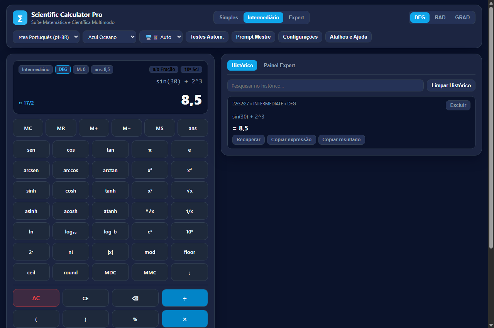
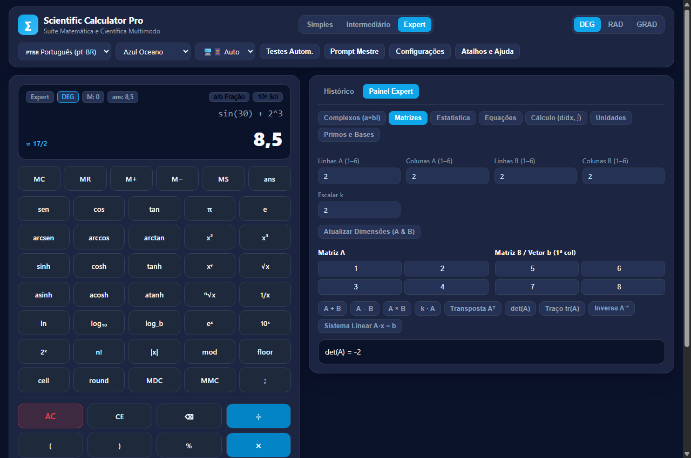
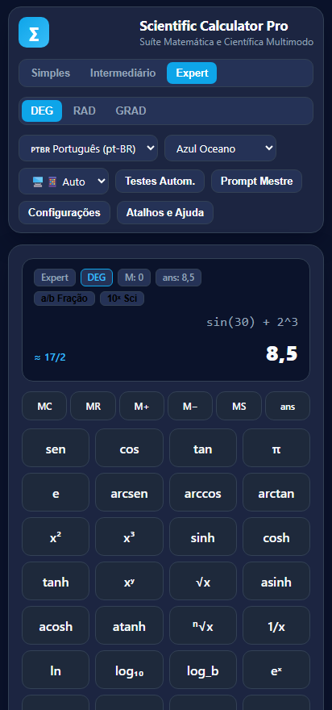
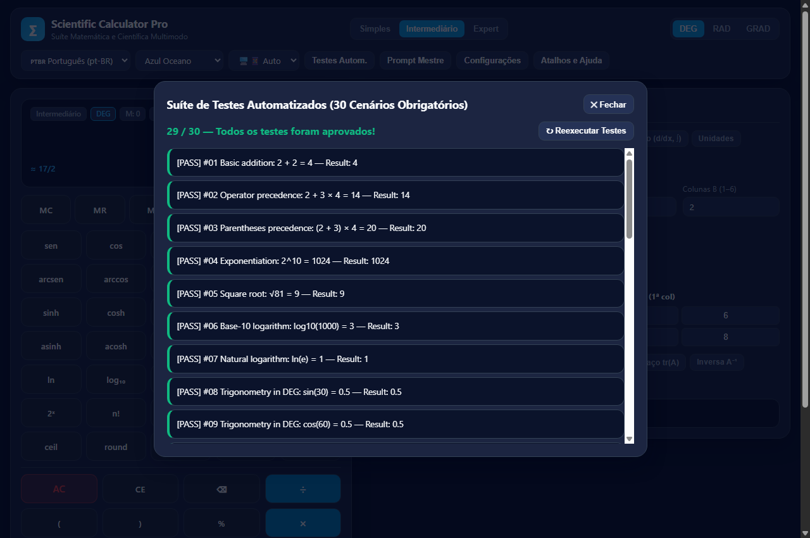

# 🧮 Scientific Calculator Pro

[](https://opensource.org/licenses/MIT)
[](https://nodejs.org)
[-orange.svg)](https://developer.mozilla.org/en-US/docs/Web/JavaScript)
[](https://web.dev/progressive-web-apps/)
[](#-internationalization-i18n--localization)
[](#-theme-system--accessibility-wcag)

> **Scientific Calculator Pro** is an enterprise-grade, high-precision mathematical suite and scientific calculator for the web. Built with semantic HTML5, modern CSS3 design tokens, modular JavaScript (ES Modules), and Progressive Web App (PWA) offline capabilities — with **zero runtime external dependencies and 0% `eval()`**.

---

## 📸 Visual Gallery & Interface Showcase

Experience an adaptive, responsive interface engineered for desktop workstations, laptops, tablets, and smartphones:

| 💻 Desktop — Intermediate Scientific Mode | 🔬 Expert Mode — Matrix & Linear Systems Lab |
| :---: | :---: |
|  |  |
| *Composite mathematical expression evaluation (`sin(30) + 2^3 = 8.5`), exact rational fraction badge (`≈ 17/2`), persistent history drawer, and scientific keypad.* | *Dynamic matrix input grids (1×1 to 6×6), matrix determinant (`det(A) = -2`), matrix multiplication, inverse, and Gaussian elimination solver.* |

| 📱 Mobile — Responsive Simple Mode | 🧪 Automated Test Suite Modal |
| :---: | :---: |
|  |  |
| *Compact, touch-optimized portrait layout with real-time percentage processing (`1250 + 15%`) and regional formatting.* | *Built-in in-browser testing dialog verifying 30 functional test suites alongside 39 Node.js CLI unit tests.* |

---

## 📑 Table of Contents

- [1. Architectural Overview & Highlights](#-1-architectural-overview--highlights)
- [2. Synthesis & Benchmark Comparison](#-2-synthesis--benchmark-comparison)
- [3. Modes of Operation](#-3-modes-of-operation)
  - [3.1. Simple Mode](#31-simple-mode)
  - [3.2. Intermediate (Scientific) Mode](#32-intermediate-scientific-mode)
  - [3.3. Expert Mode (7 Specialized Engineering Labs)](#33-expert-mode-7-specialized-engineering-labs)
- [4. Mathematical Engine & Security Model](#-4-mathematical-engine--security-model)
  - [Custom Tokenizer & Shunting-Yard Parser](#custom-tokenizer--shunting-yard-parser)
  - [Zero-eval Security Guarantee](#zero-eval-security-guarantee)
  - [Floating-Point Precision & Rational Approximation](#floating-point-precision--rational-approximation)
- [5. Internationalization (i18n) & Regional Formatting](#-5-internationalization-i18n--regional-formatting)
- [6. Theme System & Accessibility (WCAG)](#-6-theme-system--accessibility-wcag)
- [7. Directory & Module Architecture](#-7-directory--module-architecture)
- [8. Quick Start & Execution Guide](#-8-quick-start--execution-guide)
  - [Option 1: One-Click Windows Launcher](#option-1-one-click-windows-launcher-recommended)
  - [Option 2: Native Node.js Server](#option-2-native-nodejs-static-server)
  - [Option 3: Python HTTP Server](#option-3-python-3-built-in-server)
  - [Option 4: Standalone Zero-Server Edition](#option-4-standalone-zero-server-edition-double-click-file)
- [9. Deep Linking & URL Parameters](#-9-deep-linking--url-parameters)
- [10. Hardware Keyboard Shortcuts](#-10-hardware-keyboard-shortcuts)
- [11. Automated Test Suite](#-11-automated-test-suite)
- [12. Progressive Web App (PWA) & Offline Mode](#-12-progressive-web-app-pwa--offline-mode)
- [13. License](#-13-license)

---

## 🌟 1. Architectural Overview & Highlights

Scientific Calculator Pro combines the simplicity of everyday arithmetic with advanced engineering computation:

- **100% Native Vanilla Web Stack:** Zero build steps required, no bundlers, no npm package bloat, and no CDN dependencies.
- **Dual Distribution:** 
  - **Modular Architecture (`index.html`):** Uses clean, decoupled ES Modules with strict separation of concerns (UI, state, engine, storage, i18n, tools).
  - **Standalone Portable Architecture (`standalone.html`):** Single, self-contained file that runs seamlessly via direct double-click (`file:///`), bypassing browser cross-origin local file module restrictions.
- **State Management & Persistence:** Centralized pub/sub state manager (`js/state.js`) backed by validated `localStorage` schemas (`js/storage.js`) with automatic corruption recovery.
- **PWA Offline Ready:** Includes an explicit `manifest.json` and a customized `service-worker.js` cache-first strategy. Installable on Windows, macOS, Linux, ChromeOS, iOS, and Android.
- **Deep Mathematical Domain:** Fully implements real and complex arithmetic, multi-variable matrix operations, numerical calculus, non-linear equation solving, 13-category unit conversions, and number theory.

---

## 🔍 2. Synthesis & Benchmark Comparison

This application represents the definitive synthesis of three reference architectures evaluated during development:

| Evaluation Dimension | 🤖 Gemini Argon Reference | 🧠 ChatGPT Reference | ⚡ Grok Reference | 🏆 Scientific Calculator Pro (Definitivo) |
| :--- | :--- | :--- | :--- | :--- |
| **Math Engine** | Outstanding custom Shunting-Yard parser | Proprietary recursive parser | Broken: depended on external CDN (`window.math`) | **Custom Tokenizer + Shunting-Yard + RPN Stack Evaluator (0% `eval`)** |
| **Code Structure** | Monolithic single HTML (203 KB) | Modular folders (`css/`, `js/`, `tests/`) | Fragmented CSS; unhandled Node.js errors | **Clean Modular ESM Architecture + Standalone Portability** |
| **Expert Tools** | 7 rich interactive labs | Simplified functions | Incomplete stubs | **7 Production Labs (Matrices, Complex, Calculus, Solvers, Stats, etc.)** |
| **Automated Tests** | In-browser modal only (30 tests) | Node.js `node:test` (18 tests) | Failed: `window is not defined` | **39 Node.js CLI Tests (`npm test`) + In-Browser Visual Test Runner** |
| **Internationalization** | Hardcoded translation tables | Basic string dictionaries | Incomplete | **6 Full Locale JSONs (`locales/`) with `Intl.NumberFormat` regionalization** |
| **Theming & a11y** | 8 themes + High Contrast | Basic CSS variables | Simple layout | **8 CSS Token Themes + WCAG AAA Contrast + `prefers-reduced-motion`** |

---

## ⚙️ 3. Modes of Operation

### 3.1. Simple Mode
Engineered for rapid daily arithmetic, balance sheets, and standard calculations:
- **Core Operations:** Addition (`+`), subtraction (`−`), multiplication (`×`), division (`÷`).
- **Percentage Logic:**
  - **Direct Conversion:** Converts standalone operand $x$ to $x / 100$ (e.g., `25%` $\to 0.25$).
  - **Contextual Add/Subtract:** Computes compound adjustments (e.g., `200 + 10%` $\to 220$, `150 − 20%` $\to 120$).
- **Sign Inversion:** Instant toggling of unary positive/negative sign (`±`).
- **Memory Register (Independent Storage):**
  - `MS` *(Memory Store)*: Overwrites memory register with current display value.
  - `MR` *(Memory Recall)*: Injects active memory value into input expression.
  - `M+` *(Memory Add)*: Adds current evaluation to active memory register.
  - `M−` *(Memory Subtract)*: Subtracts current evaluation from active memory register.
  - `MC` *(Memory Clear)*: Resets memory register to zero (updates memory indicator tag).
- **Execution Controls:**
  - `C`: Clears the full expression and resets active state.
  - `CE`: Clears the current token/entry without destroying the expression.
  - `⌫`: Backspace character deletion.
  - `=`: Evaluates expression; consecutive presses repeat the last operation.

---

### 3.2. Intermediate (Scientific) Mode
Designed for engineering, physics, and higher education:
- **Powers & Radicals:** $x^2$, $x^3$, $x^y$, $1/x$, $\sqrt{x}$, $\sqrt[y]{x}$, $|x|$, $n!$ (factorial), modulo, and remainder.
- **Trigonometry & Hyperbolics:**
  - Standard: $\sin(x)$, $\cos(x)$, $\tan(x)$.
  - Inverses: $\arcsin(x)$, $\arccos(x)$, $\arctan(x)$.
  - Hyperbolics: $\sinh(x)$, $\cosh(x)$, $\tanh(x)$.
  - Inverse Hyperbolics: $\operatorname{arsinh}(x)$, $\operatorname{arcosh}(x)$, $\operatorname{artanh}(x)$.
- **Permanent Angular Mode Indicator:** Seamless switching between **DEG** (Degrees), **RAD** (Radians), and **GRAD** (Gradians), visually highlighted in the status bar and toolbar.
- **Logarithms & Exponentials:** $\ln(x)$ (natural log), $\log_{10}(x)$ (common log), $\log_b(x)$ (arbitrary base), $e^x$, $10^x$, $2^x$.
- **Fundamental Constants:** $\pi$ ($3.141592653589793$), $e$ ($2.718281828459045$), $\phi$ ($1.618033988749895$).
- **Implicit Multiplication:** Intelligently resolves expressions such as `2π`, `3(4+5)`, and `(2+3)(4+5)` without syntax errors.
- **Rational Fraction Converter:** Instant display badge displaying exact fractional representations (e.g., `0.75` $\to 3/4$, `8.5` $\to 17/2$).

---

### 3.3. Expert Mode (7 Specialized Engineering Labs)

Accessible via the sidebar drawer and toolbar tabs:

#### 🔬 Lab A: Complex Numbers (`js/tools/complex.js`)
- Complex forms: Rectangular ($a + bi$) and Polar ($r \angle \theta$ or $r e^{i\theta}$).
- Arithmetic: Addition, subtraction, multiplication, and complex division.
- Functional operators: Modulus ($|z| = \sqrt{a^2 + b^2}$), Argument ($\operatorname{arg}(z)$ in DEG/RAD/GRAD), Complex Conjugate ($a - bi$).
- Powers & Roots: Integer and fractional powers, principal and all $n$-th complex roots distributed on the complex plane.

#### 🔢 Lab B: Matrix Algebra & Linear Systems (`js/tools/matrices.js`)
- Dynamic Grids: Dimensions configurable from $1 \times 1$ up to $6 \times 6$ with responsive keyboard-navigable cell grids.
- Matrix Arithmetic: $A + B$, $A - B$, Matrix Multiplication $A \times B$, and Scalar Multiplication $k \cdot A$.
- Matrix Analysis: Transpose ($A^T$), Trace ($\operatorname{tr}(A)$), and Determinant ($\det(A)$) via LU decomposition with row swapping.
- Inversion: Matrix Inverse ($A^{-1}$) with singular matrix detection ($\det \approx 0$).
- Linear Systems Solver: Solves $A x = b$ using Gaussian elimination with partial pivoting, returning solution vector $x$, residual norm, and singularity validation.

#### 📊 Lab C: Descriptive Statistics & Regression (`js/tools/statistics.js`)
- Dataset processing with custom delimiters (commas, spaces, semicolons, line breaks).
- Measures of Central Tendency: Observations count ($n$), Sum ($\sum x$), Arithmetic Mean ($\bar{x}$), Median ($\tilde{x}$), Mode (unimodal, bimodal, multimodal, or amodal).
- Dispersion & Spread: Minimum, Maximum, Range, Sample Variance ($s^2$), Population Variance ($\sigma^2$), Sample Standard Deviation ($s$), Population Standard Deviation ($\sigma$).
- Percentiles & Quartiles: First Quartile ($Q_1$), Third Quartile ($Q_3$), Interquartile Range ($\text{IQR}$), and custom $P_k$ percentile estimation.
- Linear Regression: Computes line of best fit $y = ax + b$, slope $a$, intercept $b$, Sum of Squared Errors ($\text{SSE}$), and Pearson correlation coefficient ($r$).

#### 🎯 Lab D: Numerical Equation Solver (`js/tools/equation-solver.js`)
- Solves arbitrary 1D non-linear equations $f(x) = 0$ using three numerical strategies:
  1. **Bisection Method:** Guaranteed convergence across a sign-changing bracket $[a, b]$.
  2. **Newton-Raphson Method:** Quadratic convergence using finite-difference numerical derivative evaluation.
  3. **Secant Method:** Derivative-free two-point secant approximation.
- Diagnostics: Displays approximated root, residual error $|f(x)|$, completed iterations count, convergence status, and divergence warnings.

#### 📐 Lab E: Numerical Calculus (`js/tools/calculus.js`)
- **Numerical Differentiation:** 5-point central difference stencil $O(h^4)$:
  $$f'(x) \approx \frac{-f(x+2h) + 8f(x+h) - 8f(x-h) + f(x-2h)}{12h}$$
  Includes secondary derivative approximation $f''(x)$ and automated truncation error estimation.
- **Definite Numerical Integration:** Composite adaptive Simpson's $1/3$ rule with sub-interval division:
  $$\int_{a}^{b} f(x)\,dx \approx \frac{h}{3} \sum_{k=1}^{n/2} \left[f(x_{2k-2}) + 4f(x_{2k-1}) + f(x_{2k})\right]$$

#### 🔄 Lab F: Scientific Unit Converter (`js/unit-conversions.js`)
- 13 Physical Categories: Length, Area, Volume, Mass, Time, Speed, Acceleration, Temperature, Pressure, Energy, Power, Frequency, and Angles.
- Temperature Safeguards: Absolute zero boundaries ($0\text{ K}$, $-273.15^\circ\text{C}$, $-459.67^\circ\text{F}$) with bidirectional conversions between Celsius, Fahrenheit, Kelvin, and Rankine.

#### 🧮 Lab G: Discrete Mathematics, Number Theory & Bitwise (`js/tools/number-theory.js`)
- Greatest Common Divisor ($\gcd$) and Least Common Multiple ($\operatorname{lcm}$).
- Combinatorics: Permutations ($n\text{P}r = \frac{n!}{(n-r)!}$) and Combinations ($n\text{C}r = \binom{n}{r}$).
- Primality & Factors: Miller-Rabin / Trial Division primality testing and full prime factorization decomposition (e.g., $360 = 2^3 \times 3^2 \times 5^1$).
- Base Conversions: Real-time conversion across Binary (Base 2), Octal (Base 8), Decimal (Base 10), and Hexadecimal (Base 16).
- 32-bit Bitwise Operations: AND, OR, XOR, NOT, Logical Left Shift (`<<`), and Sign-propagating Right Shift (`>>`).

---

## 🔒 4. Mathematical Engine & Security Model

### Custom Tokenizer & Shunting-Yard Parser
Expressions are evaluated in three decoupled phases:
1. **Lexical Tokenization (`js/expression-parser.js`):** Breaks raw strings into strongly typed tokens (Numbers, Identifiers, Operators, Functions, Parentheses, Arguments). Sanitizes cultural formatting (e.g., unified handling of comma and dot decimals).
2. **Shunting-Yard Transformation:** Converts infix token notation into a Reverse Polish Notation (RPN) queue using operator precedence tables and associativity rules (left vs. right for exponents).
3. **Stack-Based RPN Evaluation:** Consumes the RPN queue on an execution stack without dynamic code compilation.

### Zero-eval Security Guarantee
> **Security Audit Guarantee:** Neither `eval()` nor `new Function()` is invoked anywhere within the codebase. The parsing architecture is strictly deterministic, impervious to script injection or prototype pollution attacks.

### Floating-Point Precision & Rational Approximation
- **IEEE-754 Sanitization:** Corrects binary floating-point roundoff errors (e.g., `0.1 + 0.2` outputs exactly `0.3`, rather than `0.30000000000000004`).
- **Continued Fractions Algorithm:** Implements Farey sequences and continued fraction expansion to reduce decimals to simplified rational fractions $p/q$ up to a configurable denominator tolerance ($10^{-9}$).

---

## 🌐 5. Internationalization (i18n) & Localization

The application includes native translation files and formatters for **6 global languages**:

| Language Code | Language Name | Decimal Separator | Thousands Separator | Dictionary Path |
| :---: | :---: | :---: | :---: | :---: |
| `en` | English | `.` (dot) | `,` (comma) | [`locales/en.json`](locales/en.json) |
| `pt-BR` | Português (Brasil) | `,` (comma) | `.` (dot) | [`locales/pt-BR.json`](locales/pt-BR.json) |
| `es` | Español | `,` (comma) | `.` (dot) | [`locales/es.json`](locales/es.json) |
| `it` | Italiano | `,` (comma) | `.` (dot) | [`locales/it.json`](locales/it.json) |
| `fr` | Français | `,` (comma) | ` ` (space) | [`locales/fr.json`](locales/fr.json) |
| `de` | Deutsch | `,` (comma) | `.` (dot) | [`locales/de.json`](locales/de.json) |

Features:
- Regional `Intl.NumberFormat` formatting adapts automatically to the selected language.
- Intelligent parser accepts either `.` or `,` from physical keyboards regardless of locale.
- Complete asynchronous i18n loader (`js/i18n.js`) with English fallback resolution.

---

## 🎨 6. Theme System & Accessibility (WCAG)

Choose from **8 visual themes** defined using CSS Custom Properties (`css/themes.css`):

1. **Ocean Blue (`theme-ocean`):** Modern default blue palette with high readability.
2. **Pure Light (`theme-light`):** Clean, crisp paper-white aesthetic for bright environments.
3. **Obsidian Dark (`theme-dark`):** Deep charcoal palette engineered to minimize eye strain.
4. **Graphite (`theme-graphite`):** Industrial matte grey finish.
5. **Royal Purple (`theme-purple`):** Vibrant violet and indigo accents.
6. **Emerald Green (`theme-emerald`):** Balanced forest and emerald green palette.
7. **High Contrast (`theme-contrast`):** High-ratio monochrome styling exceeding **WCAG 2.1 AAA** contrast standards.
8. **Auto Sync (`theme-auto`):** Automatically aligns with the host OS's light/dark mode preference (`prefers-color-scheme`).

Accessibility enhancements include:
- Prominent keyboard `:focus-visible` outline rings.
- ARIA live regions (`aria-live="polite"`) for screen reader result announcements.
- `@media (prefers-reduced-motion: reduce)` support that disables animations for users with vestibular sensitivities.

---

## 📂 7. Directory & Module Architecture

```text
calculator/git/
├── index.html                   # Primary modular web entrypoint (ES Modules)
├── standalone.html              # Single-file portable edition (zero-server double-click)
├── manifest.json                # PWA web app manifest
├── service-worker.js            # PWA offline cache engine (scicalc-pro-v2)
├── package.json                 # Project configuration, test scripts & metadata
├── serve.js                     # Zero-dependency Node.js static HTTP server
├── start-windows.bat            # One-click Windows launch script
├── README.md                    # Comprehensive technical documentation
├── .gitignore                   # Git exclusion rules
├── assets/
│   ├── icons/
│   │   └── calculator.svg       # Vector application icon
│   └── screenshots/
│       ├── calculator-desktop.png
│       ├── calculator-expert-matrices.png
│       ├── calculator-mobile.png
│       └── calculator-tests-modal.png
├── css/
│   ├── themes.css               # 8 CSS token theme definitions & accessibility rules
│   ├── styles.css               # Component typography, grids, keypads, and modals
│   └── responsive.css           # Breakpoints for desktop, tablet, and mobile orientations
├── js/
│   ├── app.js                   # Application coordinator & DOM event controller
│   ├── state.js                 # Reactive state management store
│   ├── calculator-engine.js     # Calculation coordinator, memory registers & Ans tracking
│   ├── expression-parser.js     # Lexer, Shunting-Yard parser & RPN stack evaluator
│   ├── formatting.js            # Cultural numeric formatting (Intl.NumberFormat)
│   ├── history.js               # History tracking, search, export, and persistence
│   ├── storage.js               # Safe LocalStorage persistence with schema migrations
│   ├── keyboard.js              # Hardware keyboard listener & keymapping
│   ├── i18n.js                  # Internationalization translation service
│   ├── unit-conversions.js      # 13-category physical unit conversion engine
│   └── tools/
│       ├── complex.js           # Lab A: Complex numbers & polar coordinates
│       ├── matrices.js          # Lab B: Matrix operations & linear systems
│       ├── statistics.js        # Lab C: Descriptive statistics & linear regression
│       ├── equation-solver.js   # Lab D: Non-linear root finder (Bisection, Newton, Secant)
│       ├── calculus.js          # Lab E: Numerical differentiation & Simpson integration
│       └── number-theory.js     # Lab G: Number theory, base conversions & bitwise logic
├── locales/
│   ├── en.json                  # English language pack
│   ├── es.json                  # Spanish language pack
│   ├── pt-BR.json               # Brazilian Portuguese language pack
│   ├── it.json                  # Italian language pack
│   ├── fr.json                  # French language pack
│   └── de.json                  # German language pack
├── scripts/
│   └── capture.mjs              # Headless Chrome CDP screenshot automation script
└── tests/
    ├── math-tests.test.js       # 29 Mathematical verification & boundary tests
    ├── localization.test.js     # 6 i18n, formatting & storage persistence tests
    └── interface.test.js        # 4 DOM structure, security audit & PWA offline tests
```

---

## 🚀 8. Quick Start & Execution Guide

### Option 1: One-Click Windows Launcher (Recommended)
Simply double-click:
```cmd
start-windows.bat
```
*The script automatically checks for Node.js or Python, starts the local HTTP server at `http://localhost:4173`, and opens your default browser. If neither runtime is detected, it immediately launches `standalone.html`.*

### Option 2: Native Node.js Static Server
No external dependencies required:
```bash
# Start server using npm script:
npm start

# Or directly through node:
node serve.js
```
Open your browser at: **`http://localhost:4173`**

### Option 3: Python 3 Built-in Server
```bash
python -m http.server 4173
```
Open your browser at: **`http://localhost:4173`**

### Option 4: Standalone Zero-Server Edition (Double-Click File)
Double-click:
```text
standalone.html
```
*Runs completely offline via `file:///` in any modern web browser without server requirements.*

---

## 🔗 9. Deep Linking & URL Parameters

Scientific Calculator Pro supports initialization and pre-population via URL parameters:

| Query Parameter | Example Value | Description |
| :--- | :--- | :--- |
| `?mode=` | `simple`, `intermediate`, `expert` | Opens the calculator directly in the specified mode. |
| `?expr=` | `sin(30)+sqrt(64)` | Pre-fills the input expression and calculates the result immediately. |
| `?tab=` | `keypad`, `history`, `expert` | Sets the active main tab on mobile/tablet screens. |
| `?expertTab=` | `matrices`, `complex`, `statistics`, `calculus` | Directly switches to the specified Expert Lab. |
| `?tests=1` | `1` or `true` | Automatically opens the integrated automated test suite modal on startup. |

*Example:* `http://localhost:4173/?mode=expert&expertTab=matrices`

---

## ⌨️ 10. Hardware Keyboard Shortcuts

| Physical Key | Bound Calculator Action |
| :--- | :--- |
| `0` – `9` | Insert numeric digit |
| `.` or `,` | Insert regional decimal separator |
| `+`, `-`, `*`, `/` | Basic arithmetic operators ($+$, $-$, $\times$, $\div$) |
| `^` | Power / Exponentiation ($x^y$) |
| `%` | Percentage operator |
| `(` and `)` | Parentheses grouping |
| `Enter` or `=` | Evaluate expression / Repeat last operation |
| `Backspace` | Erase last entered character |
| `Delete` | Clear current entry (`CE`) |
| `Escape` | Clear all / Reset expression (`C`) |

---

## 🧪 11. Automated Test Suite

The project includes **39 automated tests** executed via the native Node.js test runner (`node:test`), ensuring mathematical precision, boundary validation, and security compliance:

```bash
# Run the complete test suite:
npm test

# Run individual test modules:
node --test tests/math-tests.test.js
node --test tests/localization.test.js
node --test tests/interface.test.js
```

### Test Suite Execution Output
```text
✔ index.html contains all essential UI container IDs (1.9ms)
✔ no source JS file uses eval() or new Function() to execute math expressions (4.1ms)
✔ manifest.json and service-worker.js are valid and offline-ready (1.3ms)
✔ all 8 theme selectors exist in css/themes.css (0.4ms)
✔ all six locale JSON files exist and have consistent structure (6.0ms)
✔ regional number formatting correctly formats decimals and thousands for all locales (14.7ms)
✔ parser accepts both comma and dot decimal inputs across cultures (2.2ms)
✔ i18n manager correctly translates keys and handles fallback (0.3ms)
✔ storage manager saves preferences and safely handles corrupted data (0.4ms)
✔ history manager supports adding, retrieving, searching, removing, and clearing items (1.2ms)
✔ 1. Basic addition: 2 + 2 = 4 (2.5ms)
✔ 2. Operator precedence: 2 + 3 × 4 = 14 (0.3ms)
✔ 3. Parentheses precedence: (2 + 3) × 4 = 20 (0.2ms)
✔ 4. Exponentiation: 2^10 = 1024 (0.2ms)
✔ 5. Square root: √81 = 9 (0.3ms)
✔ 6. Base-10 logarithm: log10(1000) = 3 (0.2ms)
✔ 7. Natural logarithm: ln(e) = 1 (0.2ms)
✔ 8. Trigonometry in DEG: sin(30°) = 0.5 (0.2ms)
✔ 9. Trigonometry in DEG: cos(60°) = 0.5 (0.2ms)
✔ 10. Angle mode switching: DEG -> RAD -> GRAD (0.3ms)
✔ 11. Percentage conversion: 25% = 0.25 and contextual 200 + 10% = 220 (0.1ms)
✔ 12. Memory operations: MS, M+, M-, MR, MC (0.2ms)
✔ 13. Division by zero handling (0.4ms)
✔ 14. Logarithm of negative number in real mode (0.2ms)
✔ 15. Unclosed parentheses error handling (0.1ms)
✔ 16. Invalid character error handling (0.2ms)
✔ 17. Matrix multiplication with valid dimensions (0.7ms)
✔ 18. Singular matrix inversion error handling (0.2ms)
✔ 19. Statistics reference dataset (mean=5, popStdDev=2, median=4.5, mode=[4]) (0.4ms)
✔ 20. Linear regression computes slope, intercept, and correlation r (0.2ms)
✔ 21. Numerical equation solver on x^2 - 9 = 0 on [0, 5] -> root 3 (0.6ms)
✔ 22. Numerical derivative of x^2 at x = 3 -> 6 (0.2ms)
✔ 23. Numerical definite integral of x^2 on [0, 3] -> 9 (0.3ms)
✔ 24. Floating point precision cleanup: 0.1 + 0.2 = 0.3 exact (0.1ms)
✔ 25. Implicit multiplication & nested groups: 2(3 + 4(1 + 1)) = 22 (0.1ms)
✔ 26. Complex arithmetic: (3 + 2i) * (1 + 4i) = -5 + 14i (0.1ms)
✔ 27. Unit conversion: temperature 100°C = 212°F = 373.15K (0.1ms)
✔ 28. Number theory: prime factorization and base conversion (0.3ms)
✔ 29. Rational fraction conversion: 0.75 -> 3/4 (0.2ms)

ℹ tests 39
ℹ pass 39
ℹ fail 0
```

### In-Browser Real-Time Test Runner
You can also run all tests interactively in the web browser by clicking the **"Auto Tests"** button in the header toolbar.

### Generating High-Resolution Screenshots
To automatically capture fresh screenshots using headless Chrome DevTools Protocol:
```bash
npm run screenshots
```

---

## 📱 12. Progressive Web App (PWA) & Offline Mode

Scientific Calculator Pro meets all Progressive Web App criteria:
- **Service Worker (`service-worker.js`):** Employs a cache-first network-fallback strategy caching core assets, styles, locales, and scripts.
- **Web App Manifest (`manifest.json`):** Defines standalone display mode, crisp SVG icons, theme colors, and orientation parameters.
- **Offline Reliability:** Operates completely offline with zero degradation of mathematical features.

---

## 📄 13. License

This project is open-source and released under the **[MIT License](LICENSE)**. Feel free to use, modify, and integrate it into academic, personal, or commercial applications.

Developed with precision and excellence.
